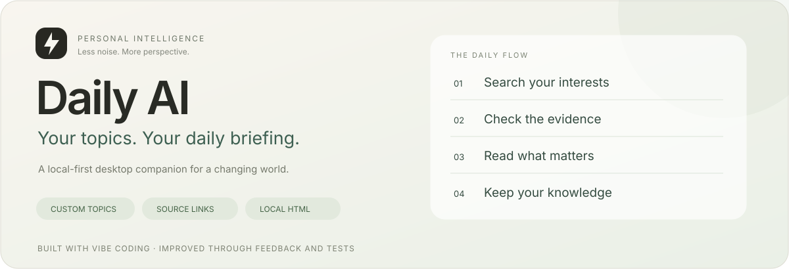
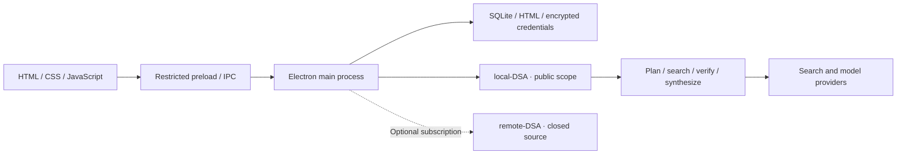

# Daily AI

**Daily AI is a local-first desktop intelligence companion that searches, checks, and distills your chosen topics into bilingual HTML briefings—with traceable sources and an archive you control.**

<p align="center"><a href="README.md">简体中文</a> · <strong>English</strong></p>



<p align="center"><a href="docs/open-source/USER_GUIDE.en.md">Get started</a> · <a href="docs/open-source/ARCHITECTURE.en.md">Architecture</a> · <a href="docs/open-source/CONTRIBUTING.en.md">Contribute</a> · <a href="docs/open-source/SCOPE.md">Source boundaries</a></p>

> Maintained by **zkccpro** and licensed under the [MIT License](LICENSE). This repository contains the Daily AI desktop application and local-DSA. remote-DSA and the standalone installer remain closed source.

<!-- official-downloads -->
## Website and downloads

[Website: www.ai4indus.com/daily-ai/](https://www.ai4indus.com/daily-ai/) · [GitHub · Star / Fork](https://github.com/Sia8Soft-plus/daily-ai)

| Windows 10+ | Download |
| --- | --- |
| Installer ZIP | [Download installer](https://www.ai4indus.com/caixuntui/#/gits/download/daily-ai-installer?serverId=19&productName=Daily-AI-Installer) |
| Portable ZIP | [Download portable app](https://www.ai4indus.com/caixuntui/#/gits/download/daily-ai-zip?serverId=19&productName=Daily-AI-zip) |

These Caixuntui download pages may require a platform account. Extract the installer ZIP and run its setup program, or fully extract the portable ZIP and run `Daily AI.exe`. An accepted Ubuntu 22.04+ release is not available yet; website buttons follow actual package availability.

The app uses **production Caixuntui** sign-in and registration. Signed-out startup opens the login dialog. First login does not activate a subscription automatically: choose your own API key or explicitly subscribe. The remote service validates account and subscription status; ordinary users do not gain administrator privileges.
<!-- /official-downloads -->

## Follow the progress, not an endless feed

Models, papers, tools, industrial deployments: finding more links is easy. Understanding what changed, why it matters, and where the evidence comes from takes time.

Daily AI makes this a desktop routine. Describe your interests, let the agent collect and organize evidence, and keep a readable briefing locally. The default topic is **AI agents and large language models**; add computer vision, manufacturing, or another field you want to follow.

| What you need | What Daily AI does |
| --- | --- |
| Topics that fit your work | Natural-language descriptions, minimum item targets, and domestic/global preferences. |
| A repeatable routine | Daily, weekday, or selected-weekday schedules; manual generation; tray and system notifications. |
| More than official announcements | General search MCP tools, topic-directed channel queries, news, and scholarly retrieval. |
| Traceable information | Original links, date evidence, topic attribution checks, and a bounded seven-day delivery ledger. |
| A readable result | Topic-based highlights and bilingual HTML; switching a new report's language does not request another translation. |
| A useful archive | Local HTML, tabs, month filters, search, favorites, recycle bin, and date-range digests. |
| A choice of model setup | Bring your own API key or connect to a separately provided subscription service. |

Minimum counts are search targets, not permission to invent facts. Insufficient evidence should be explained. Platform access restrictions and external service availability still apply.

## Two modes, one reading experience

| | Your API key | Subscription |
| --- | --- | --- |
| Processing | local-DSA launched by the app | Provider-operated remote-DSA |
| Models | Your provider, endpoint, model, and key | Managed by the service |
| Sign-in | Not required for local generation | Account and valid subscription required |
| Archive | Local HTML and SQLite | Retrieved reports are managed locally |
| Source scope | Desktop, local-DSA, search and model core | Client integration is open in scope; service implementation is closed |

**Local-first does not mean offline.** Search accesses the network. Cloud-model requests send topics and relevant evidence to your selected provider. Sharing a report uploads its HTML separately. See [Privacy and data](docs/open-source/PRIVACY.md).

## Get started

Use the Windows downloads above and extract the archive completely before running the app.

1. Choose **Settings → Generation mode → Use your API key**.
2. Enter the provider key, refresh models, and verify the connection.
3. Keep the default topic or add your interests.
4. Generate a report and follow the lower-right task card.
5. Configure scheduling, notifications, and storage.

Adapters cover GLM, OpenAI, Anthropic, Gemini, DeepSeek, Qwen, Doubao, and configurable OpenAI-compatible endpoints. Model availability depends on provider APIs, account permissions, and region; manual IDs remain available.

**Platform status:** current validation focuses on Windows, targeting Windows 10+. Ubuntu 22.04+ remains an adaptation target; Windows validation is not a Linux acceptance claim.

For development with Node.js 22.x and npm:

```bash
npm ci
npm start
```

SQLite is embedded; no database server is required. This tree installs, tests and builds independently of the remote service and installer. Run npm run verify:win for Windows regression and npm run dist:win for a ZIP with one root folder; see the [development guide](docs/open-source/DEVELOPMENT.md).

## Entirely built through vibe coding

Daily AI is developed entirely through **vibe coding**: natural-language requirements, AI-assisted design and implementation, debugging, testing, and repeated feedback from real use.

That describes a process—not an exemption from human judgment. AI makes mistakes. Contributors must understand and validate their changes. Reproducible tests and actual runtime checks remain essential. Read [How we build](docs/open-source/VIBE_CODING.md).

## Architecture at a glance



Local work runs in a separate process; the client receives streaming progress and propagates cancellation. See [Architecture](docs/open-source/ARCHITECTURE.en.md), [Development](docs/open-source/DEVELOPMENT.md), and [Testing](docs/open-source/TESTING.md).

Start contributing with a reproducible bug, a clearer interaction, a retrieval-quality example, or improved docs. See [Contribution guidelines](docs/open-source/CONTRIBUTING.en.md), [FAQ](docs/open-source/FAQ.md), [Security](SECURITY.md), and the [documentation index](docs/open-source/README.md).

Maintainer: **zkccpro** · [Public downloads / Website](https://www.ai4indus.com/daily-ai/) · [MIT License](LICENSE). Model credits are not included; third-party search services are not promised to remain free.

GitHub: [Sia8Soft-plus/daily-ai](https://github.com/Sia8Soft-plus/daily-ai) · [Releases](https://github.com/Sia8Soft-plus/daily-ai/releases)

In-app updates: click the version number → Check for updates. Download and installation require separate consent. User data is preserved and old files are removed after a successful launch. See [Update behavior](docs/open-source/UPDATES.md). Current version: 0.2.13. Builds of 0.2.12 with in-app updates can detect this release; earlier builds can be updated from the website.

Report security vulnerabilities privately to [zkcc20164020@126.com](mailto:zkcc20164020@126.com). See the [security reporting guide](SECURITY.md).

[0.2.13 release notes / 版本说明](docs/open-source/CHANGELOG-0.2.13.md)
