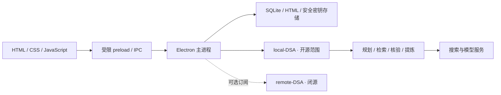

# Daily AI

**Daily AI 是一款本地优先的智能资讯桌面应用：围绕你的关注主题自动检索、核验和提炼，把值得阅读的进展整理成可追溯、可收藏的双语 HTML 日报。**

<p align="center"><strong>简体中文</strong> · <a href="README.en.md">English</a></p>


<p align="center"><a href="docs/open-source/USER_GUIDE.md">开始使用</a> · <a href="docs/open-source/ARCHITECTURE.md">技术架构</a> · <a href="CONTRIBUTING.md">参与贡献</a> · <a href="docs/open-source/SCOPE.md">开源范围</a></p>

> 由 **zkccpro** 维护，采用 [MIT 许可证](LICENSE)。本库包含 Daily AI 主应用与 local-DSA；remote-DSA 和独立安装程序不在开源范围内。

<!-- official-downloads -->
## 官网与下载

[官网：https://www.ai4indus.com/daily-ai/](https://www.ai4indus.com/daily-ai/) · [GitHub · 欢迎 Star / Fork](https://github.com/Sia8Soft-plus/daily-ai)

| Windows 10+ | 下载入口 |
| --- | --- |
| 安装引导 ZIP | [下载安装程序](https://www.ai4indus.com/caixuntui/#/gits/download/daily-ai-installer?serverId=19&productName=Daily-AI-Installer) |
| 免安装 ZIP | [下载便携版本](https://www.ai4indus.com/caixuntui/#/gits/download/daily-ai-zip?serverId=19&productName=Daily-AI-zip) |

上述采训推下载页面可能要求平台登录。安装引导 ZIP 解压后运行安装程序；免安装 ZIP 完整解压后运行 `Daily AI.exe`。Ubuntu 22.04+ 暂未提供已验收发布包，官网会按实际发布状态开放按钮。

客户端使用采训推**生产环境**账号登录/注册，未登录启动时会打开登录入口。首次登录不自动开通任何套餐，可自行选择本地 API Key 或订阅。账号与套餐由远程服务校验，普通平台账号不因此获得管理端权限。
<!-- /official-downloads -->

## 每天追上进展，不必每天追着信息跑

新模型、新论文、新工具、新的产业落地……真正困难的不是找到更多链接，而是持续看清：**发生了什么、为什么值得关注、证据在哪里。**

你描述关注方向，Daily AI 检索相关线索、整理重点，再把结果留在本地。默认关注「AI 智能体与大模型」，也可追踪视觉研究、制造业应用，或你自己的专业领域。

| 你关心的事 | Daily AI 如何处理 |
| --- | --- |
| 信息是否贴近我？ | 自然语言自定义主题；逐主题配置最低条目目标与国内／全球偏好。 |
| 能否持续追踪？ | 每日、工作日或每周指定日期更新；手动生成、托盘常驻与系统通知。 |
| 不想只看到官网新闻？ | 通用搜索 MCP、主题驱动的渠道路由、新闻与学术检索共同收集公开线索。 |
| 如何判断是不是又一篇转述？ | 回溯来源，保留链接与日期，结合主题归属检查和一周内已推送记录去重。 |
| 不想读满屏长文？ | 分主题提炼重点；新报告内置中英文内容，切换语言无需再次请求翻译。 |
| 希望知识能积累下来？ | 本地 HTML，多标签、月份筛选、搜索、收藏、回收站和日期汇聚。 |
| 希望保留选择权？ | 使用自己的模型 API Key，也可连接另行提供的订阅服务。 |

最低条目数是搜索目标，不是编造保证。证据不足时应说明缺口，不以重复内容凑数；公开平台的访问限制和外部服务可用性会影响结果。

## 两种使用方式，一套阅读体验

| | 本地 API Key | 订阅服务 |
| --- | --- | --- |
| 执行位置 | 随客户端启动的 local-DSA | 服务提供者运行的 remote-DSA |
| 模型配置 | 自选厂商、地址、模型和密钥 | 服务端管理模型 |
| 账号要求 | 本地生成无需登录 | 账号与有效订阅权限 |
| 报告管理 | 本地 HTML + SQLite | 领取后在本地管理 |
| 代码边界 | 主应用、local-DSA、搜索与模型核心开放 | 客户端连接代码开放，远程服务实现闭源 |

**本地优先不等于离线运行。** 搜索需要网络；使用云模型时会向所选厂商发送主题与用于生成的资料。主动分享文档会另行上传 HTML，见 [数据与隐私](docs/open-source/PRIVACY.md)。

## 开始使用

Windows 下载入口见上方，完整解压后开始使用。

1. 在「设置 → 生成方式」选择「配置 API Key」。
2. 选择模型厂商，填写 Key，再刷新模型列表并验证连接。
3. 保留默认主题，或添加你真正想持续追踪的方向。
4. 点击「立即生成日报」，在右下角查看实际任务进度。
5. 配置更新计划、数据目录和通知。

接入范围包含 GLM、OpenAI、Anthropic、Gemini、DeepSeek、通义千问、豆包及可配置的 OpenAI 兼容接口。模型发现受厂商接口、账号权限和地域影响，必要时可手填模型 ID。

**平台状态：** 当前验证以 Windows 为主，目标支持 Windows 10+；Ubuntu 22.04+ 是适配目标，不能把本轮 Windows 验证等同于 Linux 完整验收。

### 从源码启动

开发环境使用 Node.js 22.x 和 npm，进入工程目录：

```bash
npm ci
npm start
```

SQLite 由运行时提供，不需要单独安装数据库服务。本库可独立安装、测试和构建，不需要 remote-DSA 或安装程序源码。运行 `npm run verify:win` 检查 Windows 版本，运行 `npm run dist:win` 生成单层目录 ZIP。见 [开发指南](docs/open-source/DEVELOPMENT.md)。

## 100% 基于 vibe coding 开发

这个项目完全基于 **vibe coding** 开发：用自然语言提出需求，与 AI 协作形成设计、编写代码、排查问题，再结合真实使用反馈持续迭代。

这描述的是开发过程，不代表不需要人工判断。AI 会犯错，界面与后台都有需要补齐的细节；代码检查、可复现测试和实际运行验证不可省略。**“AI 写出来的”不是跳过质量责任的理由。** 见 [开发方式](docs/open-source/VIBE_CODING.md)。

## 简洁的架构



本地任务在独立子进程中执行，客户端接收流式进度；取消沿任务链传播。[架构文档](docs/open-source/ARCHITECTURE.md) 进一步介绍数据流、调度、去重和故障处理。

## 文档与贡献

| 入口 | 内容 |
| --- | --- |
| [使用指南](docs/open-source/USER_GUIDE.md) | 配置、计划、文档管理与迁移 |
| [开发指南](docs/open-source/DEVELOPMENT.md) | 目录、开发、调试与构建 |
| [技术架构](docs/open-source/ARCHITECTURE.md) | 进程边界、检索链路和数据流 |
| [接口约定](docs/open-source/API.md) | IPC、local-DSA、可选远程连接 |
| [测试指南](docs/open-source/TESTING.md) | 回归与检索质量评估 |
| [常见问题](docs/open-source/FAQ.md) | 模型、计划、检索和故障恢复 |
| [贡献指南](CONTRIBUTING.md) | Issue、PR 与 AI 辅助贡献 |
| [安全报告](SECURITY.md) | 私密报告与脱敏 |
| [文档总览](docs/open-source/README.md) | 完整文档导航 |

欢迎从一个可复现的 bug、一处更清晰的交互、一份检索质量样例或一段更好的文档开始。[路线图](docs/open-source/ROADMAP.md) 不预设交付日期。

---

维护者：**zkccpro** · [公开下载 / 官网](https://www.ai4indus.com/daily-ai/) · [MIT 许可证](LICENSE)。项目不附送模型 API 额度，不承诺第三方搜索服务永久免费。

GitHub: [Sia8Soft-plus/daily-ai](https://github.com/Sia8Soft-plus/daily-ai) · [Releases](https://github.com/Sia8Soft-plus/daily-ai/releases)

应用内更新：右上角版本号 → 检查更新。下载和退出安装分别确认，用户数据保留，新版启动成功后才清理旧版；见[更新说明](docs/open-source/UPDATES.md)。当前版本 0.2.13。已具备检查更新功能的 0.2.12 可直接检测新版；更早版本请从官网下载安装。

安全漏洞请私密报告至 [zkcc20164020@126.com](mailto:zkcc20164020@126.com)，详见 [安全报告指南](SECURITY.md)。

[0.2.13 release notes / 版本说明](docs/open-source/CHANGELOG-0.2.13.md)
