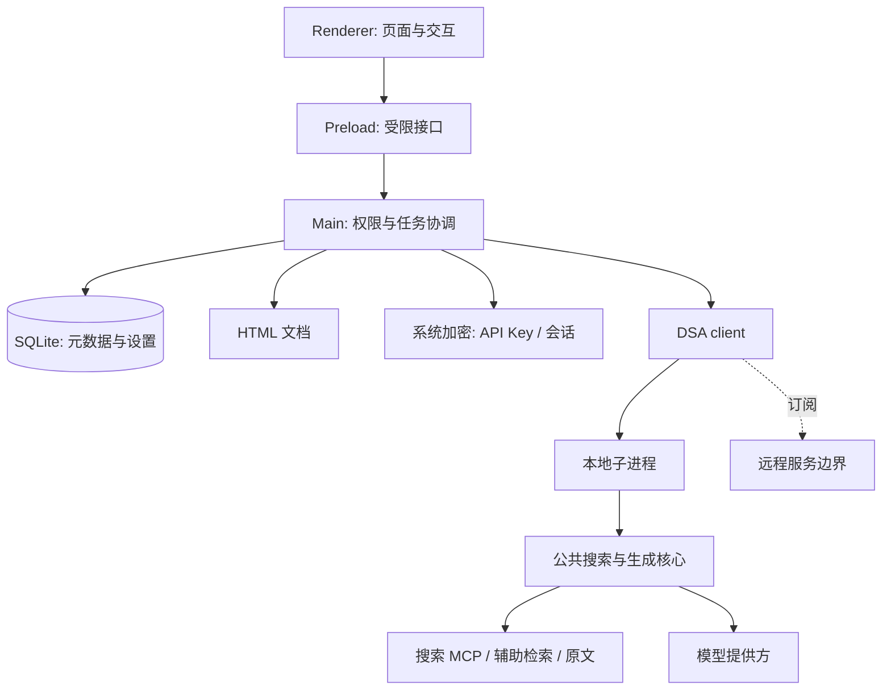

# 技术架构

[English](ARCHITECTURE.en.md)

Daily AI 将阅读与本地文档管理留在桌面端，将检索、模型调用和内容提炼放到 DSA 执行层。客户端使用相同任务交互连接 local-DSA 或 remote-DSA；服务端实现属于闭源范围。

## 进程与数据边界

Electron 主进程负责窗口、托盘、单实例、调度与持久化；preload 暴露有限接口，页面不获得 Node 全权限。本地 DSA 通过子进程隔离长任务，监听回环地址随机端口，用每次启动生成的凭据验证请求。

## 生成链路

1. 获取启用主题快照，规范化配置并检查已有日报及可复用缓存。
2. 按主题语义规划查询、渠道、时间与地区偏好，避免只依赖固定源列表。
3. 并行收集公开线索，经通用搜索 MCP、辅助新闻／学术检索等渠道召回；失败按预算重试或换查询。
4. 获取原文与日期证据，判断主题相关性、来源与重复关系。不将网页中的指令当作系统指令。
5. 对每个主题独立补查并检查条目目标；不足应说明，不把其他主题内容移入凑数。
6. 与近 7 天已推送指纹比对，再生成重点、双语正文及来源信息。
7. 校验结构，写入 HTML 与文档元数据，更新历史、通知与任务终态。

渠道覆盖取决于公开可访问性。微信公众号、视频号、社交账号或论坛线索不代表可获取所有平台内容。共同使用搜索能力不要求生成模型必须是某一厂商。

## 状态、取消与恢复

UI 展示实际任务事件；任务只有一个最终状态：成功、失败或取消。关闭提示与中断执行是不同操作。取消沿 IPC、RPC 和模型／搜索请求传递；阶段超时、总时限和心跳避免无限等待。模型返回不合规结构需校验和有限修复，不能无限重试。

增量复用以主题配置快照为依据；仅当日期、配置和缓存完整性满足条件才跳过检索。已推送库保存有限指纹，按 7 天窗口过期并设置容量上限，当前上限 50,000；这降低精确重复，不能保证语义去重完美。

## 本地存储与计划

SQLite WAL 保存元数据、设置、主题与任务相关记录；HTML 存独立文件。系统安全存储保护密钥，文档本身并非默认加密。删除、回收站与物理文件操作须保持一致，统计排除回收站。

计划以本机时间和时区计算，提前准备；需考虑休眠恢复、错过时间、重复触发与运行锁。应用彻底退出后本地执行停止。远程计划仅发送必要主题／计划，领取报告后在本地管理。

## 可选远程边界

客户端调用登录、订阅、任务与分享接口。权益由远端校验，本地状态不构成授权依据。普通远程待领取结果有有限保存期，主动分享文档另行保存至撤销。接口公开不要求公开用户系统适配、管理员、计费或部署实现。

本地入口与 RPC 位于 dsa/local；共享 HTML 清洗位于 shared/html-sanitizer.js；订阅界面使用独立模拟契约数据进行测试。本库没有对 remote-DSA 实现的源码依赖，见 [范围](SCOPE.md)。
